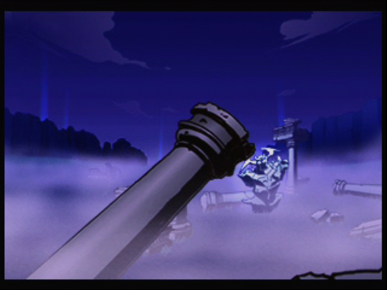
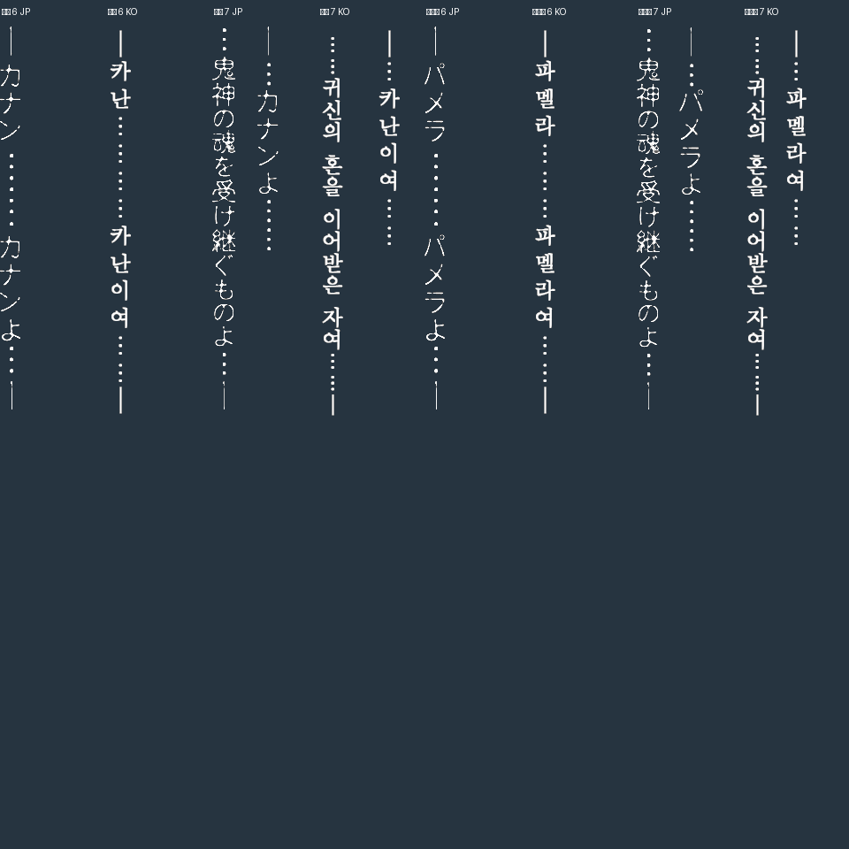
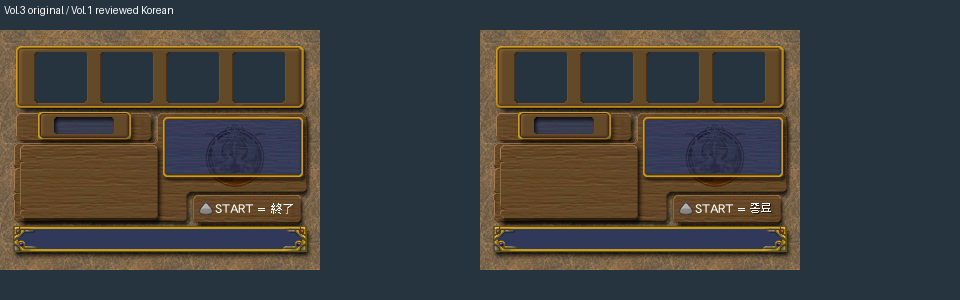

# DC-El-Dorado-Gate-Volume-3-Kr

**엘도라도 게이트 Vol.3 · 비공식 한글화 1.0 정식 버전**

일본판 **Vol.3 v1.001**용 한글 패치입니다. 대사·시스템·아이템·브라우저·오프닝·추가 콘텐츠를 번역하고,
원래 다운로드 상품 **77종**을 오프라인에서 구매할 수 있도록 설정했습니다.
Vol.1의 공통 번역·그림·글꼴·도구를 재사용하고 Vol.3 전용 문구와 화면 배치를 보완했습니다.
공개 버전은 **v1.0**, 내부 검증 빌드는 **v0.31**입니다. v0.9의 게임 데이터를 유지하며 Demul에서 원본·한글판 부팅과 한글 오프닝 자막을 확인해 정식 배포합니다.
기존 `El-Dorado-Gate-Volume-3-Kr` 저장소를 **DC-El-Dorado-Gate-Volume-3-Kr**로 변경했습니다.


## 다운로드

**[v1.0 릴리스](https://github.com/OldManCraveGuitars-bit/DC-El-Dorado-Gate-Volume-3-Kr/releases/tag/v1.0)**

| 파일 | 용도 |
| --- | --- |
| [DC-El-Dorado-Gate-Volume-3-Kr-v1.0-Patcher.exe](https://github.com/OldManCraveGuitars-bit/DC-El-Dorado-Gate-Volume-3-Kr/releases/download/v1.0/DC-El-Dorado-Gate-Volume-3-Kr-v1.0-Patcher.exe) | **Windows x64 단독 EXE 패처. 이 파일 하나로 적용할 수 있습니다.** |
| [DC-El-Dorado-Gate-Volume-3-Kr-v1.0.zip](https://github.com/OldManCraveGuitars-bit/DC-El-Dorado-Gate-Volume-3-Kr/releases/download/v1.0/DC-El-Dorado-Gate-Volume-3-Kr-v1.0.zip) | EXE·설명·스크린샷·자산 비교·해시·라이선스·수동 적용용 xdelta |
| [SHA256SUMS-v1.0.txt](https://github.com/OldManCraveGuitars-bit/DC-El-Dorado-Gate-Volume-3-Kr/releases/download/v1.0/SHA256SUMS-v1.0.txt) | EXE·ZIP·xdelta의 SHA-256 |

패치 데이터·매니페스트·xdelta3 엔진·라이선스를 EXE 안에 내장했습니다.
Python이나 별도 xdelta 설치는 필요하지 않습니다. 원본 게임 GDI와 세 트랙은 사용자가 준비합니다.
원본·완성 게임 이미지, BIOS, 에뮬레이터와 VMU 저장 파일은 배포하지 않습니다.

## 적용 방법

1. **Eldorado Gate Vol. 3 v1.001 (2000)(Capcom)(NTSC)(JP)[!]** 원본 3트랙 GDI를 준비합니다.
2. EXE를 실행해 원본 GDI를 선택합니다. GDI가 가리키는 세 트랙은 같은 폴더에 있어야 합니다.
3. 약 1.3GB 이상의 여유 공간이 있는 **새 출력 폴더**를 지정합니다.
4. **한글 패치 적용**을 누릅니다. 원본 해시 검사, 패치, 결과 해시 확인과 트랙 복사를 수행합니다.
5. 새 폴더의 **`DC-El-Dorado-Gate-Volume-3-Kr-v1.0.gdi`**를 실행합니다. GDI와 세 트랙을 함께 유지하세요.

원본은 덮어쓰지 않으며 이미 존재하는 출력 폴더에는 적용하지 않습니다.
이미 패치한 롬에 덧씌우는 업데이트가 아닙니다. v1.0도 **일본판 원본 GDI**에서 새로 적용하세요.

## 비공식 한글화 1.0 정식 버전

- **Demul 실행 확인**: Vol.1을 실행했던 **DEmul 0.7 BUILD 280418 / gpuDX11 / gdrImage** 환경을 복사해 일본판 원본 Vol.3과 한글판을 비교했습니다. 원본 오프닝과 한글판 부팅·한글 오프닝 자막을 확인했고 사용자도 정상 실행을 확인했습니다.
- **게임 데이터**: v0.9와 바이트까지 같으며 별도 롬 수정은 필요하지 않았습니다. 시작 파일의 원래 LBA 548331과 크기 1,369,376바이트를 유지합니다.
- **실행 방법**: 이미지 플러그인에서 GDI를 선택해 실행하세요. 명령행에서는 `demul.exe -run=dc -image="C:\Games\Vol3\DC-El-Dorado-Gate-Volume-3-Kr-v1.0.gdi"`처럼 이미지 경로까지 명시합니다. 이번 초기 시험에서는 이미지 인수를 빠뜨린 상태가 Demul 기본 화면에 머물렀고 두 인수를 함께 전달하자 정상 실행됐습니다.
- **배포 도구**: EXE 패처·Windows 파일 정보·내장 매니페스트·출력 GDI 이름·체크섬을 v1.0으로 갱신했습니다. 새 EXE의 원본 적용 결과와 세 트랙·GDI 전체 해시를 확인했습니다.
- **검증 범위**: 이번 빠른 실행 확인은 부팅·한글 오프닝 재생 범위입니다. 타이틀·메뉴 조작, 각성 장면 재진행, 실기 구동, 7·8장과 엔딩까지의 완주는 포함하지 않습니다.

여기서 **정식 버전**은 비공식 한글화 프로젝트의 배포 버전을 뜻합니다.

| Demul 일본판 원본 오프닝 | Demul 한글판 오프닝 |
| --- | --- |
|  |  |


[Demul 실행 검증](https://github.com/OldManCraveGuitars-bit/DC-El-Dorado-Gate-Volume-3-Kr/blob/v1.0/docs/DEMUL-v1.0.json) · [캡처 출처](https://github.com/OldManCraveGuitars-bit/DC-El-Dorado-Gate-Volume-3-Kr/blob/v1.0/docs/screenshot-provenance.json)

## 포함된 누락·UI 수정 (v0.9에서 반영)

- **카난·파멜라 각성 문구 4장**: 일반 문자열 목록에서 빠졌던 세로 PAT 그림을 한글화했습니다. Vol.1과 같은 바탕체를 사용하고 원래 좌표·타일 범위·기준점을 유지했습니다.
- **석상 애니메이션 보존**: 두 컨테이너의 문구 프레임 6·7만 교체했습니다. 석상 애니메이션 12프레임과 각 컨테이너의 그림 뱅크 17개, 원래 좌표와 포인터 표를 유지했습니다.
- **파티 선택 종료 안내 4곳**: `START = 終了`를 `START = 종료`로 바꿨습니다. 원본 픽셀이 일치하는 Vol.1 검수 이미지를 재사용했습니다.
- **옵션 종료 문구**: 기존 추출기가 빠뜨린 ASCII `EXIT`를 **나가기**로 바꿨습니다. 원래 네 칸의 폭을 검사합니다.
- **합성 화면 표기**: **합성결과 / 첫번째 무기 / 두번째 무기 / 첫번째 방어구 / 두번째 방어구**로 통일했습니다.
- **편집기 0.1.12**: 각성 그림의 원문·한글 비교, PNG 교체·저장·재빌드와 나가기 문구의 폭 검사를 지원합니다. 독립 EXE에서 동일한 최종 GDI를 재현했습니다.
- **배포 이름 정리**: 저장소·패처 파일명·출력 GDI·Windows 버전 정보와 내장 매니페스트를 **DC-El-Dorado-Gate-Volume-3-Kr / v1.0**로 맞췄습니다.

기존 패치 파일 **59개**와 한글 글꼴 **1,043칸**은 v0.85와 같습니다.
새 그림 8장과 UI 표기 6개가 반영되어 등록된 번역은 **17,200개**입니다.

아래는 **원본 ROM 자산과 한글 자산의 비교**입니다. 실제 실행 스크린샷과 구분합니다.





[누락 조사와 한계](https://github.com/OldManCraveGuitars-bit/DC-El-Dorado-Gate-Volume-3-Kr/blob/v1.0/docs/omission-audit.json) · [실제 GDI 검증](https://github.com/OldManCraveGuitars-bit/DC-El-Dorado-Gate-Volume-3-Kr/blob/v1.0/docs/omission-verification.json) · [자산 이미지 출처](https://github.com/OldManCraveGuitars-bit/DC-El-Dorado-Gate-Volume-3-Kr/blob/v1.0/docs/asset-review-provenance.json)

## 누적 한글화 내용

| 항목 | 반영 내용 |
| --- | --- |
| 본편 대사·시스템 | 4,973개 레코드. 기존 원문·번역 대조 검수, 문맥·호칭·줄 길이·제어 코드 검사 유지 |
| 추가 콘텐츠 | 용어 31항목·인물 42항목·줄거리 31페이지·몬스터 107개의 제목·본문 총 **338개**, 메뉴·배너 문구 **14개** |
| 아이템·적 이름 | 아이템명 10,941개, 적 이름 112개. 등급·변형별 반복 레코드 포함 |
| 브라우저 | 텍스트 823개, 메뉴·설정·키보드 등의 이미지 문구 419개와 한글 배경 로고 |
| 저장·고정 메시지 | 날짜 글자 3개, VMU 설명 6개, 획득 안내 등의 짧은 메시지 조각 4개 |
| 오프닝 | 화면 문구 21개·노랫말 9개, 총 30개 자막과 한글 로고. 원래 ADX 음성 섹터 보존 |
| 엔딩 | 두 종류 44페이지. 역할명·제작진 이름과 한글화 크레딧, 원래 순서·좌표·그림 보존 |
| 다운로드 상점 | 무기 33·방어구 25·액세서리 19, 총 **77종**. 원래 가격·능력치·효과 보존 |

추가 콘텐츠의 강조색·속성·장비 그림 기호·페이지 번호를 보존합니다.
도감의 `????????`는 정상 저장 데이터에서 아직 열리지 않은 항목이며 강제로 개방하지 않았습니다.
다운로드 상점은 담당 NPC와 원래 대화를 마치고 구매하는 방식이며 외부 DLC나 인터넷 연결은 필요하지 않습니다.
이전 검수에서 배틀 아머 400z 판매와 에어 레이피어 100z 구매 후 잔금·아이템의 정상 VMU 저장과 새 부팅 불러오기를 확인했습니다.

### 이전 UI·글꼴 수정 포함

- 시나리오 제목 **수몰된 도시로 / 파멜라의 기억**은 Vol.1 1.7.13과 같은 바탕체, 금색 명암과 1px 그림자를 사용합니다. 원래 타일 범위에 맞춘 22px·28px입니다.
- 상태 배지 **독·혼·마·사·공·방·염·속·회**는 Vol.1 실제 디스크의 12×12 픽셀과 같고 원래 고정 슬롯 18개를 유지합니다.
- 상태창 **특수능력**은 공백 없이 원래 네 글자 96px 영역 안에 표시합니다.
- 본문·추가 콘텐츠 119곳의 폭·줄 수, 장비 비교 렌더러 8개의 괄호, 권·화·수집 수치 좌표를 보정했습니다.
- 작은 광고·메뉴 글씨에는 전기칩 한글 12px 비트맵과 정수 배율을 사용했습니다. 설정 X/Y 겹침과 오우거 스톤 교환소 제목의 장식 침범을 수정했습니다.


이전 버전 상세 기록: [v0.9](https://github.com/OldManCraveGuitars-bit/DC-El-Dorado-Gate-Volume-3-Kr/blob/v1.0/docs/RELEASE-v0.9.md) · [v0.85](https://github.com/OldManCraveGuitars-bit/DC-El-Dorado-Gate-Volume-3-Kr/blob/v1.0/docs/RELEASE-v0.85.md) · [v0.8](https://github.com/OldManCraveGuitars-bit/DC-El-Dorado-Gate-Volume-3-Kr/blob/v1.0/docs/RELEASE-v0.8.md) · [v0.75](https://github.com/OldManCraveGuitars-bit/DC-El-Dorado-Gate-Volume-3-Kr/blob/v1.0/docs/RELEASE-v0.75.md)

## 실제 실행 스크린샷

위의 Demul 캡처 2장과 아래의 기존 실행 캡처 13장, 총 **15장**을 제공합니다. 아래 13장은 이전 v0.25~v0.29 및 v0.75 검수 때 촬영했으며 기존 빌드 출처를 유지합니다. 각성·종료 문구는 ROM 자산 비교로 제공합니다.
각 캡처의 실제 빌드·해시는 [스크린샷 출처](https://github.com/OldManCraveGuitars-bit/DC-El-Dorado-Gate-Volume-3-Kr/blob/v1.0/docs/screenshot-provenance.json)에 기록했습니다.

| 추가 콘텐츠 메뉴 | 사전·인물·줄거리 |
| --- | --- |
|  |  |
|  |  |
|  |  |
|  |  |
|  |  |
|  |  |

## 검증 범위

- 게임 파일 **923개**의 크기·SHA-256을 검사했습니다. 변경 **72개**, 원본 내용 보존 **851개**입니다.
- 변경 **15,446개 섹터**의 EDC/ECC와 원본 트랙 보존, 트랙 2의 **LBA 600**을 확인했습니다.
- 실제 GDI에서 본편 문자열 **4,973개**, 포인터 **5,138개**, 새 그림 8장의 픽셀·좌표·애니메이션 보존을 검사했습니다.
- 등록 문구 **17,200개**의 배치 오류는 0개입니다. 등록 후보의 미반영 항목은 0개이며 전체 원문 추출 완료를 의미하지 않습니다.
- 독립 디스크립터 3,921개와 원본 이미지 목록 9,610개·별도 PAT 1,035패턴을 조사했습니다. OCR은 후보 검출을 돕는 보조 검사이며 전수 번역을 증명하지 않습니다.
- 편집기 통합 검사 **19개**, 최근 이식 회귀 검사 **7개**, 패처 안전 검사 **7개**를 통과했습니다.
- Vol.1 폴더와 별도 Python 도구가 없는 환경의 **편집기 EXE가 동일한 최종 트랙**을 만들었습니다.
- 새 **패처 EXE 하나만** 분리한 상태에서 원본 GDI에 적용했습니다. 결과 GDI와 세 트랙의 전체 해시가 검증본과 같습니다.

현재 게임 데이터의 Demul 새 부팅·한글 오프닝을 확인했습니다. 타이틀·메뉴 조작, 각성 장면 재진행, 실기 구동, 7·8장과 엔딩까지의 완주 검증은 하지 않았습니다.
기존 정상 진행의 전투·획득·VMU 저장/불러오기·상점 구매·브라우저 조작 검증 기록을 유지합니다.
오프닝 전체 디코딩·타이밍·원래 음성은 검사했으며 30개 자막 각각의 실제 재생은 추가 확인 범위입니다.
공식 타사 홍보 로고·저작권·기술 표기와 장식 그림은 유지했습니다. 엔딩 인명 4건은 임시 독음으로 기록했습니다.

[검증 요약](https://github.com/OldManCraveGuitars-bit/DC-El-Dorado-Gate-Volume-3-Kr/blob/v1.0/docs/verification.json) · [패처 검사](https://github.com/OldManCraveGuitars-bit/DC-El-Dorado-Gate-Volume-3-Kr/blob/v1.0/docs/patcher-verification.json) · [편집기 검사](https://github.com/OldManCraveGuitars-bit/DC-El-Dorado-Gate-Volume-3-Kr/blob/v1.0/docs/editor-verification.json) · [변경 파일 72개 해시](https://github.com/OldManCraveGuitars-bit/DC-El-Dorado-Gate-Volume-3-Kr/blob/v1.0/docs/changed-files-sha256.json) · [인명 독음 기록](https://github.com/OldManCraveGuitars-bit/DC-El-Dorado-Gate-Volume-3-Kr/blob/v1.0/docs/credit-reading-notes.json)

## SHA-256

| 파일 | 원본 SHA-256 | v1.0 적용 후 SHA-256 |
| --- | --- | --- |
| `track01.bin` | `e100c442c927b313e282aa2a34659bc3aeae5f27cf173640c2a9bd913d2b8499` | `e100c442c927b313e282aa2a34659bc3aeae5f27cf173640c2a9bd913d2b8499` |
| `track02.raw` | `cd7c82d88f21e4ebb32a94c65f15f625df871c933d6d78cbf85c671778a6ffca` | `cd7c82d88f21e4ebb32a94c65f15f625df871c933d6d78cbf85c671778a6ffca` |
| `track03.bin` | `ae452974db251a6ca20901c2fd1779f919e8ae157c3546284f9f0ad79baa365a` | `4245c9fabe08089ce7836916f838949a80f091c2400226cf921e6b87d9c02c78` |

출력 GDI SHA-256: `025516557d49e1835e7eb8571e09244b64db190cf3981ead555c54b1924ca19f`

패처 EXE SHA-256: `36325bdf269b3d120c2a0ad795b547086009ff0286c996e78516b18bc1d96120`

패치 데이터 SHA-256: `69ef13835f7e1ef2ce9048690d4f0266da6a1f9a4faf9220d3d42e039571ae77`

[전체 해시·크기](https://github.com/OldManCraveGuitars-bit/DC-El-Dorado-Gate-Volume-3-Kr/blob/v1.0/hashes.json) · [해시 설명](https://github.com/OldManCraveGuitars-bit/DC-El-Dorado-Gate-Volume-3-Kr/blob/v1.0/docs/HASHES.md) · [배포 파일 체크섬](https://github.com/OldManCraveGuitars-bit/DC-El-Dorado-Gate-Volume-3-Kr/releases/download/v1.0/SHA256SUMS-v1.0.txt)

```powershell
Get-FileHash -Algorithm SHA256 .\DC-El-Dorado-Gate-Volume-3-Kr-v1.0-Patcher.exe
```

## 패처 소스와 라이선스

[패처 소스](https://github.com/OldManCraveGuitars-bit/DC-El-Dorado-Gate-Volume-3-Kr/blob/v1.0/tools/patcher.py) · [빌드 스크립트](https://github.com/OldManCraveGuitars-bit/DC-El-Dorado-Gate-Volume-3-Kr/blob/v1.0/tools/build-patcher.ps1) · [안전 검사](https://github.com/OldManCraveGuitars-bit/DC-El-Dorado-Gate-Volume-3-Kr/blob/v1.0/tools/test_patcher.py) · [재빌드 방법](https://github.com/OldManCraveGuitars-bit/DC-El-Dorado-Gate-Volume-3-Kr/blob/v1.0/docs/BUILD.md)

패처는 Vol.1의 MIT 라이선스 도구를 Vol.3 트랙·내장 패치에 맞춰 변경했습니다.
xdelta3 3.2.1은 [공식 배포](https://github.com/jmacd/xdelta/releases/tag/v3.2.1)의 Windows x64 엔진을 사용합니다.
바탕체는 래스터 결과만 포함하며 Windows 폰트 파일은 배포하지 않습니다.
새 패처와 재사용 패처 코드는 MIT, xdelta3는 Apache 2.0, 갈무리·MaruMinya·전기칩 글꼴은 SIL OFL 1.1입니다.
Python·Tcl/Tk·PyInstaller·글꼴·엔진 고지는 [licenses](https://github.com/OldManCraveGuitars-bit/DC-El-Dorado-Gate-Volume-3-Kr/tree/v1.0/licenses/)와 EXE의 **라이선스** 버튼에서 볼 수 있습니다.
원작 게임·캐릭터·그림·상표의 권리는 각 권리자에게 있습니다.

ZIP SHA-256: `d2734dda7afb6a35c12d60bf6aadf5b86e0eb0eae26a73012a398b6dcfc7b162`
